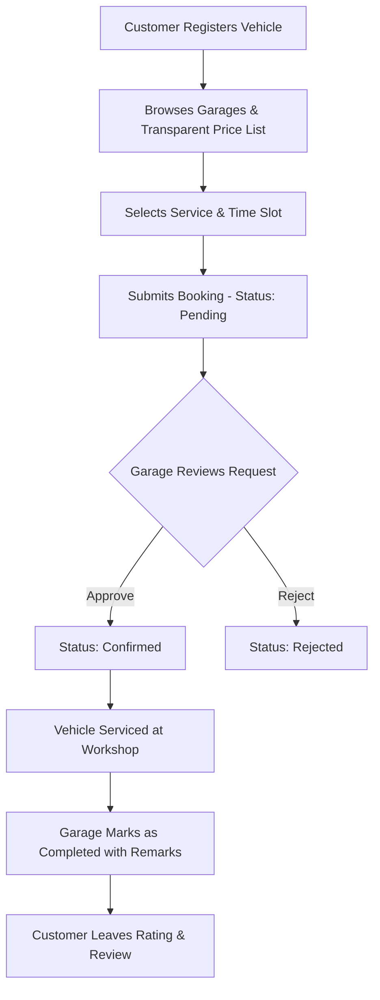

# 📊 PowerPoint Presentation Outline (Hackathon Deliverable)
**SR University Web Technologies and Mobile Programming Hackathon 2026**  
**Problem Statement 20: Vehicle Service Booking System**

---

### Slide 1: Title Slide
- **Project Title:** AutoServe Pro – Online Vehicle Service Booking & Garage Management System
- **Event:** SR University Web Technologies & Mobile Programming Hackathon 2026
- **Problem Statement:** #20
- **Team Name / Student Names:** [Your Name / Team Members]
- **Date:** November 2026

---

### Slide 2: Problem Statement & Motivation
- **Challenges in Traditional Servicing:**
  - Phone call-based appointments lead to miscommunication, double bookings, and long waiting times at garages.
  - Lack of transparency in pricing (hidden charges) and unclear service options.
  - No real-time status tracking for customers after vehicle drop-off.
  - Garage owners lack a centralized dashboard to manage appointments and customer history.
- **Our Solution:** A lightweight, role-based full-stack web application connecting vehicle owners, garages, and system administrators.

---

### Slide 3: System Architecture & Tech Stack
- **Frontend Layer:** Semantic HTML5, Responsive CSS3, Vanilla JavaScript (zero external UI dependencies, fast loading).
- **Backend API Layer:** Node.js, Express.js RESTful API architecture.
- **Database Layer:** MySQL Server 8.0 relational database (`vehicle_service_db`) with foreign key constraints.
- **Security:** bcryptjs password hashing and JSON Web Tokens (JWT) for secure session handling.

---

### Slide 4: Database Design (Entity-Relationship)
- **`users` Table:** Stores profiles with roles (`customer`, `garage`, `admin`).
- **`vehicles` Table:** Linked to customer; stores registration number, model, and vehicle type.
- **`service_centers` Table:** Stores garage address, contact, price list (JSON), and time slots.
- **`bookings` Table:** Links customer, vehicle, and garage with live status (`Pending`, `Confirmed`, `Rejected`, `Completed`).
- **`feedback` Table:** Stores 1–5 star ratings and reviews for completed bookings.

---

### Slide 5: Core Workflow & Lifecycle

---

### Slide 6: Key Features & Demonstrations
- **Step-Wise Booking Engine:** Automatic vehicle-to-center pairing with dynamic live price calculation.
- **Garage Operations Dashboard:** Single-click approval, rejection, and job completion with technician remarks.
- **Customer Status Tracker:** Real-time color-coded badges (Yellow = Pending, Blue = Confirmed, Green = Completed, Red = Rejected).
- **Live Demo Switcher:** Instant one-click persona switching (Rahul, Speedy Garage, System Admin) for jury testing.

---

### Slide 7: Live Demo Video / Presentation Flow
1. **Persona 1 (Rahul - Customer):** Log in & view registered vehicles (`Hyundai i20`). Book `Full Service` at *Speedy Auto Care* for Nov 25.
2. **Persona 2 (Speedy Auto Care - Garage):** Switch to garage view. See incoming appointment in table. Click "Confirm".
3. **Servicing Completed:** Garage updates status to "Completed" with remarks: *"Servicing done, oil changed."*
4. **Persona 1 (Customer Feedback):** Customer dashboard shows "Completed" pill and opens "Leave Feedback" modal to give 5 stars.
5. **Admin Monitoring:** Admin views system KPIs: total users, active bookings, and partner garages.

---

### Slide 8: Future Enhancements & Conclusion
- Integration of SMS/WhatsApp notification APIs.
- Real-time location-based garage filtering using Google Maps API.
- In-app payment gateway (Razorpay/UPI).
- **Conclusion:** A scalable, authentic student project solving a practical real-world problem with clean code.
